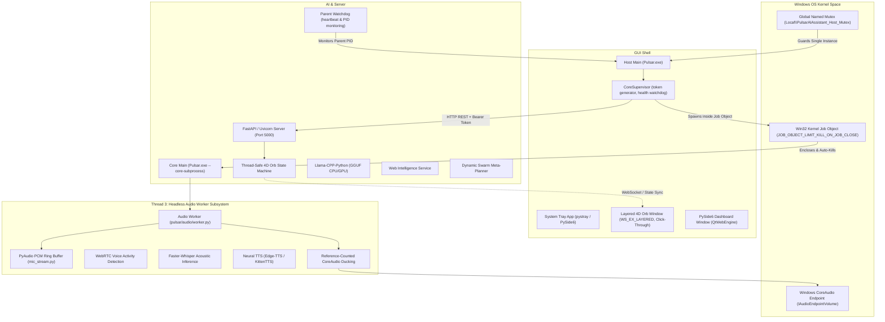

# 🏛️ Architecture Guide: Pulsar Standalone 3-Tier Architecture

## 📌 Architectural Vision: Paradigm B Dual-Mode Binary
The **Pulsar Standalone Architecture** is engineered for Windows 10/11 production deployments. It solves the classic dilemma in desktop AI engineering: **How do you build a rich, responsive desktop GUI companion while hosting massive multi-gigabyte AI models (GGUF, Whisper, PyTorch) without UI freezes, memory leaks, or orphaned background processes?**

The answer is **Paradigm B: Strict Process Isolation with Win32 Kernel Job Object Supervision**.



---

## 🔒 The Paradigm B Invariant Guarantees

| Process Identity | What It CAN Do | What It Is STRICTLY FORBIDDEN From Doing |
| :--- | :--- | :--- |
| **Native Host Process** (`pulsar/host/`) | Render PySide6 windows, manage system tray, render transparent click-through 4D Orb, generate auth tokens, launch child processes inside Job Objects. | **NEVER** import `torch`, `llama_cpp`, `faster_whisper`, `sounddevice`, or backend ML models. Must launch in <1 second with <60 MB RAM. |
| **Headless Core Subprocess** (`pulsar/core/`) | Host FastAPI server, load GGUF weights, run Faster-Whisper, execute agent chains, query SQLite databases, execute web searches. | **NEVER** import `PySide6`, `QtWebEngine`, or display GUI dialogs. Must run 100% headless. |
| **Audio Worker Subsystem** (`pulsar/audio/`) | Stream microphone PCM audio, run VAD, execute wake-word detection, duck master audio. | **NEVER** import GUI toolkits or block the main core event loop. |

---

## 🛡️ Kernel-Level Safety Guarantees

### 1. Win32 Job Object Automatic Teardown (`pulsar/host/job_object.py`)
* When the Host launches the Core subprocess, it assigns the Core's process handle to a Windows Kernel Job Object.
* Configures `JOBOBJECT_EXTENDED_LIMIT_INFORMATION` with `JOB_OBJECT_LIMIT_KILL_ON_JOB_CLOSE = 0x2000`.
* **Kernel Guarantee**: When the Host process handle is closed (by user closing the app, a crash, or Task Manager termination), the Windows OS kernel **instantly terminates the Core subprocess and all its child workers**. Zero orphaned background processes can ever linger in memory.

### 2. Dual Parent Watchdog (`pulsar/core/watchdog.py`)
In addition to the kernel Job Object, the Core subprocess runs an asynchronous background watchdog thread:
* Polls `os.kill(parent_pid, 0)` every 1.5 seconds.
* If the parent host process dies unexpectedly without closing the job object, the watchdog logs a heartbeat failure and calls `os._exit(0)` to release all GPU VRAM and system memory.

### 3. Screen-Share Stealth Mode Exclusion (`pulsar/host/windows_integration.py`)
* Invokes `SetWindowDisplayAffinity(hwnd, WDA_EXCLUDEFROMCAPTURE)` on the 4D Orb and companion dashboard.
* Keeps assistant widgets completely invisible to screen recording tools (OBS Studio, Zoom, Microsoft Teams, Discord).

### 4. Single-Instance Mutex (`pulsar/host/__main__.py`)
* Obtains `CreateMutexW(None, True, "Local\\PulsarAIAssistant_Host_Mutex")` at boot.
* If another instance is running, brings the existing window to the foreground and immediately exits.

---

## 🔌 Inter-Process Communication (IPC) & Token Security

The Host and Core communicate over loopback HTTP (`http://127.0.0.1:5000`):
1. **Cryptographic Token Exchange**: At startup, `CoreSupervisor` generates a high-entropy random token (`secrets.token_hex(24)`) and passes it to the Core via the `--token` CLI argument.
2. **Token-Gated Routes**: Sensitive endpoints (`/shutdown`, `/api/orb/state`, `/health`) require the matching token in `X-Pulsar-Token` header or `?token=` parameter.
3. **Origin & Host Guard**: Rejects any non-loopback requests to prevent DNS rebinding attacks.

---

## 🌟 4D Particle Orb Architecture (`orb_window.py` & `static/orb.html`)
The floating Orb is a signature capability of PULSAR:
* **Window Styling**: Rendered in a borderless window with `WS_EX_LAYERED`, `WS_EX_TRANSPARENT`, and `WS_EX_TOOLWINDOW` (omitted from taskbar Alt-Tab cycle).
* **WebGL Acceleration**: Uses Three.js 4D particle meshes that dynamically adjust particle dispersion, rotational velocity, color palette, and wave harmonics based on the assistant's internal operational state (`idle`, `listening`, `thinking`, `speaking`, `error`).
* **State Transition Speed**: State updates propagate via REST/WebSocket in <15ms.

---

## 🧪 Testing the 3-Tier Architecture

Exhaustive test benches validate each tier independently:
```powershell
# Phase 2: Headless Core, health, origin guard, token security, and watchdog
pytest tests/test_phase2_core_headless.py -v

# Phase 3: Host supervisor, Job Objects, Mutex, Tray, and Orb rendering
pytest tests/test_phase3_host.py -v

# Phase 4: Zero-GUI audio worker, stream capture, and wake matching
pytest tests/test_phase4_audio.py -v

# Phase 5: Native packaging, shortcuts, AppUserModelID, and pythonw safety
pytest tests/test_phase5_windows_app.py -v
```
All Phase 2, 3, 4, and 5 tests pass with 100% success rate on Windows 10 and 11.
