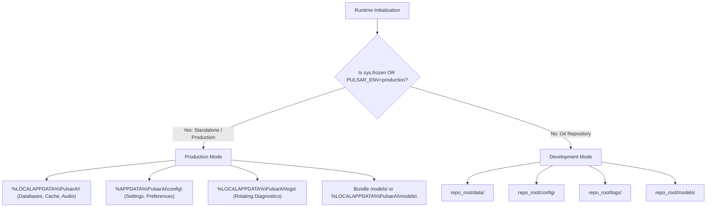

# 🏛️ Enterprise Zero-Hardcoded Storage Architecture

## 📌 Architectural Vision & Motivation
Early versions of desktop AI projects frequently suffer from brittle, machine-specific hardcoded paths (e.g. `C:\Users\username\...`, `E:\Projects\...`). When installed on another developer's machine or bundled into an installer executable, hardcoded paths lead to immediate crashes, permission errors (such as attempting to write to `C:\Program Files\`), and sensitive credential leaks.

To solve this permanently, **PULSAR** implements an **Enterprise Zero-Hardcoded Storage Architecture** via [`core_ai/config/paths.py`](file:///d:/Projects/Ai_Assistant/core_ai/config/paths.py) and [`core_ai/core/database_config.py`](file:///d:/Projects/Ai_Assistant/core_ai/core/database_config.py).

---

## 🏗️ Path Resolution Matrix: Development vs. Production

The system automatically detects its execution environment and partitions data between read-only application code and writable user data:



| Path Category | Development Mode (`PULSAR_ENV=dev`) | Windows Production Mode (`sys.frozen=True`) | Linux / macOS Fallback |
| :--- | :--- | :--- | :--- |
| **Application Code** | `d:\Projects\Ai_Assistant\` | `sys._MEIPASS` or `app_dir` (Read-Only) | `/opt/pulsar` or `/usr/local/share` |
| **Writable User Data** | `<repo_root>/data/` | `%LOCALAPPDATA%\PulsarAI\` | `~/.local/share/pulsar/` |
| **User Configuration** | `<repo_root>/config/` | `%APPDATA%\PulsarAI\config\` | `~/.config/pulsar/` |
| **Diagnostic Logs** | `<repo_root>/logs/` | `%LOCALAPPDATA%\PulsarAI\logs\` | `~/.local/state/pulsar/logs/` |
| **Model Weights** | `<repo_root>/models/` | `app_dir/models` (or env override) | `~/.cache/pulsar/models/` |

---

## 🗄️ Database Registry & Concurrency Management (`database_config.py`)

All SQLite databases in PULSAR are registered through a central dictionary resolver and initialized with enterprise concurrency pragmas:

### 1. The Central Database Registry
* `personal_knowledge.db` / `historical_rag.db`: Long-term episodic memory, full-text search (FTS5), and RAG vector traces.
* `commitments.db`: User tasks, commitments, reminders, and calendar obligations.
* `app_usage.db`: Life interaction learner tracking active window patterns and dwell time.
* `projects.db` / `gnn.db`: Swarm meta-planner project graphs and workflow DAG memory.
* `meta_learning.db` / `rl_ppo.db`: Reinforcement learning agent policy buffers.

### 2. High-Concurrency SQLite Pragmas
Every database connection invokes standard production pragmas:
```sql
PRAGMA journal_mode=WAL;      -- Write-Ahead Logging allows simultaneous reads during writes
PRAGMA synchronous=NORMAL;    -- Fast, safe fsync on modern SSDs
PRAGMA busy_timeout=5000;     -- Wait up to 5 seconds if a lock is contested instead of throwing 'database is locked'
PRAGMA foreign_keys=ON;       -- Enforce referential integrity
```

---

## 🛡️ Crash Recovery & Safe Teardown (`crash_handler.py`)

To protect user databases against power loss or sudden process termination:
1. **Unhandled Exception Hook (`sys.excepthook`)**: Captures unhandled exceptions, writes structured trace JSON into `%LOCALAPPDATA%\PulsarAI\logs\crash_dumps\`, and commits active SQLite transactions.
2. **Windows Signal Handlers (`SIGTERM`, `SIGINT`, `SIGBREAK`)**: Flushes all in-memory buffers (such as the life interaction learner buffer and voice vocabulary registry) before calling `sys.exit()`.
3. **Database Integrity Verifier**: On application boot, runs `PRAGMA integrity_check` on all core SQLite databases. If corruption is detected, safely restores from the most recent automatic timestamped backup in `data/scattered_backups/`.

---

## ⚙️ Environment Variable Overrides

Developers can override any default path at runtime without modifying code:

```bash
# Force custom directories
export PULSAR_DATA_DIR="D:\CustomData\Pulsar"
export PULSAR_CONFIG_DIR="D:\CustomConfig"
export PULSAR_LOGS_DIR="D:\CustomLogs"
export PULSAR_MODELS_DIR="D:\AI_Models\GGUF"

# Switch mode explicitly
export PULSAR_ENV="production"  # or "development"
```

---

## 🧪 Testing & Verification
The production storage architecture is validated by automated unit tests in [`tests/unit/test_production_storage_and_paths.py`](file:///d:/Projects/Ai_Assistant/tests/unit/test_production_storage_and_paths.py):
```powershell
pytest tests/unit/test_production_storage_and_paths.py -v
```
Verifies:
- Dynamic fallback when environment variables are unset.
- AppData path resolution under simulated `sys.frozen`.
- WAL mode concurrency under multi-threaded writes.
- Clean directory migration from legacy project locations.
