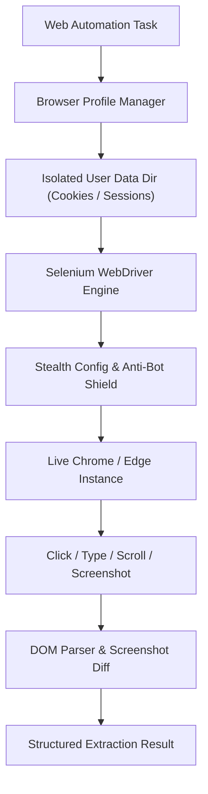

# 🌐 Subsystem Guide: Browser Automation & Dynamic Scraping

## 📌 Architecture Overview
The **Browser Automation & Dynamic Scraping** subsystem equips the assistant with full programmatic control over web browsers (Chrome, Edge, Chromium). It enables user authentication persistence via custom browser profiles, dynamic JavaScript-rendered single-page app (SPA) interaction, form submission, and anti-detection automation.

---

## 🧩 Core Subsystem Modules

| Module File | Component Name | Description & Technology |
| :--- | :--- | :--- |
| [`browser_automation.py`](file:///d:/Projects/Ai_Assistant/core_ai/src/ai_assistant/automation/browser_automation.py) | **Browser Controller** | Main Selenium automation engine providing headless and visible window browser manipulation. |
| [`browser_profiles.py`](file:///d:/Projects/Ai_Assistant/core_ai/src/ai_assistant/automation/browser_profiles.py) | **Profile & Cookie Manager** | Maintains isolated user data directories so logged-in web sessions (e.g. Gmail, GitHub) persist across assistant restarts. |
| [`web_routes.py`](file:///d:/Projects/Ai_Assistant/backend/routes/web_routes.py) | **Web Actions API** | Exposes HTTP routes to launch browser sessions, navigate to URLs, click elements, and fetch live HTML. |

---

## ⚡ Key Technical Features

1. **Persistent Session Profiles:** Saves cookies, local storage, and cached logins in `user_data/browser_profiles/` so the assistant does not prompt for repeated two-factor authentications.
2. **Dynamic Waiting:** Implements explicit `WebDriverWait` with expected conditions (`visibility_of_element_located`) rather than brittle `time.sleep()` statements.
3. **Anti-Detection Stealth:** Automatically strips `navigator.webdriver` flags to allow legitimate automation of public services without triggering false bot rejections.
