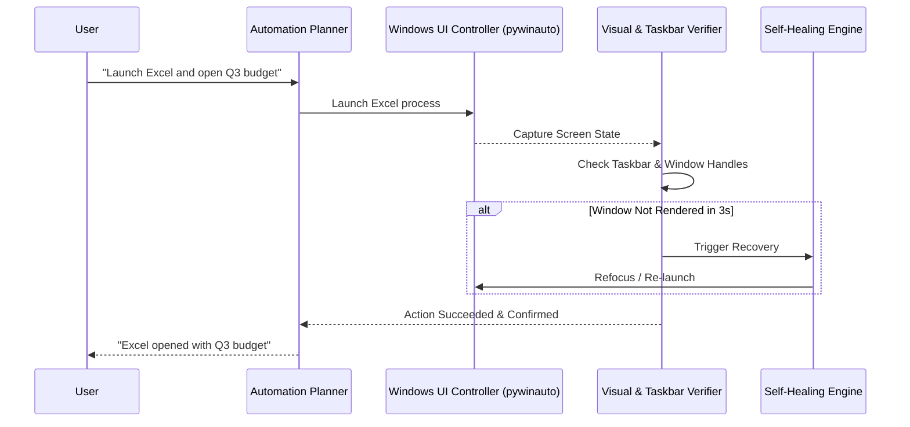

# 🖥️ Subsystem Guide: Desktop & GUI Automation

## 📌 Architecture Overview
The **Desktop & GUI Automation** subsystem allows `Ai_Assistant` to operate native Windows desktop applications, web browsers, and system taskbars. Unlike naive coordinate clickers, this subsystem employs a **Closed-Loop Visual Verification & Self-Healing Architecture**:

---

## 🧩 Core Subsystem Modules

| Module File | Component Name | Description & Technology |
| :--- | :--- | :--- |
| [`app_automation.py`](file:///d:/Projects/Ai_Assistant/core_ai/src/ai_assistant/automation/app_automation.py) | **Native Application Controller** | Controls Windows software via Microsoft UI Automation (UIA) and Win32 accessibility trees through `pywinauto`. |
| [`window_manager.py`](file:///d:/Projects/Ai_Assistant/core_ai/src/ai_assistant/automation/window_manager.py) | **Window Manager** | Enumerates top-level window handles (HWND), brings windows to focus, minimizes, maximizes, and arranges side-by-side splits. |
| [`live_taskbar_analysis.py`](file:///d:/Projects/Ai_Assistant/core_ai/src/ai_assistant/automation/live_taskbar_analysis.py) | **Live Taskbar Analyzer** | Inspects the Windows taskbar in real-time, detecting running application icons, notification badges, and system tray states. |
| [`visual_verification.py`](file:///d:/Projects/Ai_Assistant/core_ai/src/ai_assistant/automation/visual_verification.py) | **Visual Verifier** | Captures post-action screen diffs to ensure that buttons actually clicked, text actually pasted, or dialogs appeared. |
| [`self_healing.py`](file:///d:/Projects/Ai_Assistant/core_ai/src/ai_assistant/automation/self_healing.py) | **Self-Healing Engine** | When a click or keystroke fails due to unexpected popups or focus changes, attempts recovery strategies (dismiss popup, re-focus, retry). |

---

## ⚡ Technical Configuration (`config/`)

* `AUTOMATION_SAFETY_LEVEL`: Safety tier (`high` requires confirmation before typing/clicking in unknown apps; `standard` auto-executes).
* `SCREENSHOT_ON_FAIL`: Automatically saves debug screenshots to `outputs/screenshots/` whenever an action fails.
* `ACTION_DELAY_MS`: Delay between synthetic mouse/keyboard actions (default: `150ms`) to simulate human cadence and prevent GUI race conditions.

---

## 🛡️ Safety & Failsafes
* **Fail-Safe Corner:** Moving the physical mouse cursor to any corner of the screen immediately aborts active automated execution loops via PyAutoGUI failsafe.
* **Non-Invasive Verification:** Does not inject DLLs or hook system memory; uses standard sanctioned Windows Accessibility APIs and screenshot diffing.
