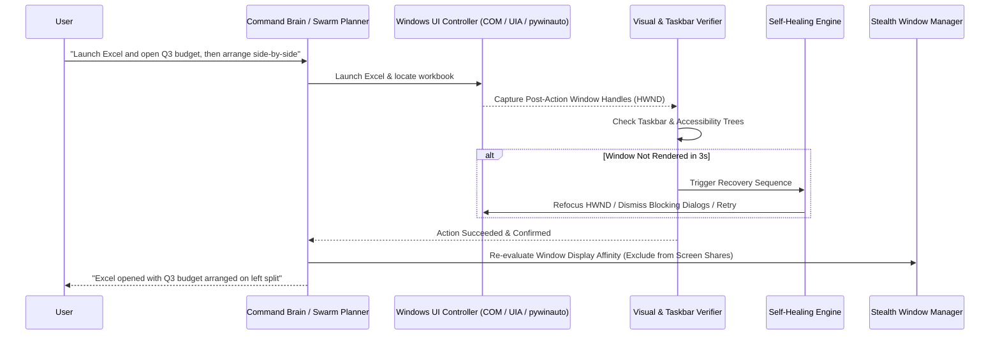

# 🖥️ Subsystem Guide: Desktop & GUI Automation

## 📌 Architecture Overview
The **Desktop & GUI Automation** subsystem empowers PULSAR to operate native Windows 10/11 desktop software, web browsers, system taskbars, and active window states. Unlike naive coordinate-based clickers, PULSAR implements a **Closed-Loop Visual Verification, Windows COM Automation, and Self-Healing Architecture**:



---

## 🧩 Core Subsystem Modules (`core_ai/automation/`)

| Module File | Component Name | Description & Capabilities |
| :--- | :--- | :--- |
| [`automation_engine.py`](file:///d:/Projects/Ai_Assistant/core_ai/automation/automation_engine.py) | **Automation Engine** | Master executor synthesizing keystrokes, mouse events, and clipboard operations with human cadence debouncing. |
| [`system_automation.py`](file:///d:/Projects/Ai_Assistant/core_ai/automation/system_automation.py) | **System Automation** | Direct Windows COM and shell controller (volume adjustments, media control, lock/sleep/shutdown, brightness). |
| [`window_manager.py`](file:///d:/Projects/Ai_Assistant/core_ai/automation/window_manager.py) | **Window Manager** | Enumerates HWNDs, manages window tiling, side-by-side splits, minimize, maximize, and multi-monitor placement. |
| [`app_discovery.py`](file:///d:/Projects/Ai_Assistant/core_ai/automation/app_discovery.py) | **App Discovery Engine** | Scans Start Menu, AppData, and Registry to automatically discover installed programs and generate canonical alias mappings. |
| [`browser_profiles.py`](file:///d:/Projects/Ai_Assistant/core_ai/automation/browser_profiles.py) | **Multi-Profile Browser Controller** | Manages dedicated Chrome/Edge user profiles, cookies, and sessions for WhatsApp Web, YouTube, and portal automation. |
| [`advanced_verification.py`](file:///d:/Projects/Ai_Assistant/core_ai/automation/advanced_verification.py) | **Advanced Verification Engine** | Closed-loop screenshot diffing and OCR confirmation ensuring target UI elements changed state as expected. |
| [`live_taskbar_analysis.py`](file:///d:/Projects/Ai_Assistant/core_ai/automation/live_taskbar_analysis.py) | **Live Taskbar Analyzer** | Inspects taskbar icons, system tray items, and unread notification badges in real-time. |
| [`emergency_stop.py`](file:///d:/Projects/Ai_Assistant/core_ai/core/emergency_stop.py) | **Emergency Stop Guard** | Debounced hardware and voice abort controller. Instantly terminates automation loops when user says *"stop"* or triggers hotkey. |

---

## 🛡️ Screen-Share Stealth Mode Exclusion (`windows_integration.py`)

When sharing your screen during meetings (Zoom, Microsoft Teams, Discord, Google Meet, OBS Studio):
* **The Risk**: Floating assistant widgets, private notifications, or automated windows can inadvertently expose sensitive data to remote participants.
* **The Solution**: PULSAR invokes the native Windows API:
  ```python
  import ctypes
  user32 = ctypes.windll.user32
  WDA_EXCLUDEFROMCAPTURE = 0x00000011  # Exclude from desktop capture in Win 10 2004+
  user32.SetWindowDisplayAffinity(hwnd, WDA_EXCLUDEFROMCAPTURE)
  ```
* **Result**: The 4D Orb and companion dashboard remain completely visible and interactive on your physical monitor, but appear as black or completely transparent to screen-recording and screen-sharing software.

---

## 🛑 Debounced Emergency Stop System (`emergency_stop.py`)

Automated mouse and keyboard actions must have instantaneous, foolproof abort mechanisms:
1. **Physical Mouse Failsafe**: Slamming the physical mouse cursor into any corner of the primary display (`(0,0)`, `(0,max_y)`, etc.) triggers an immediate hardware `PyAutoGUI` fail-safe interrupt.
2. **Debounced Voice Abort**: Saying *"Stop"*, *"Ruko"*, *"Cancel"*, or *"Emergency Stop"* is detected by the zero-latency acoustic keyword matcher. The system debounces rapid repeated utterances, halts active keyboard/mouse worker threads, and restores system volume.
3. **Global Keyboard Hotkey**: Pressing `Ctrl + Alt + Shift + S` immediately aborts any running automation chain.

---

## 🌐 Specialized Integration Automations

### 1. Multi-Profile Chrome & WhatsApp Web (`browser_profiles.py` & `whatsapp.py`)
* Operates dedicated isolated user data directories (`%LOCALAPPDATA%\PulsarAI\automation\chrome_profile\`).
* Preserves WhatsApp Web authentication QR sessions across restarts.
* Features phonetic contact name search matching Hindi/English variations (e.g. *"Ramesh ko message bhejo"*).

### 2. Native Windows Media Automation (`system_automation.py`)
* Controls system volume, mute, play/pause, next track via Windows Virtual Key codes (`VK_VOLUME_UP`, `VK_VOLUME_DOWN`, `VK_MEDIA_PLAY_PAUSE`).
* Hinglish media command normalization (`play gaana`, `gana chalao`, `volume tez karo`).

---

## 🧪 Testing Desktop Automation

Run unit and integration test benches:
```powershell
# Test emergency stop and compound action orchestration
pytest tests/test_emergency_and_compound_orchestration.py -v

# Test command differentiation and routing
pytest tests/test_command_differentiation_and_routing.py -v

# Test taskbar detection and UI inspection
pytest tests/features/test_taskbar_detection.py -v
```
