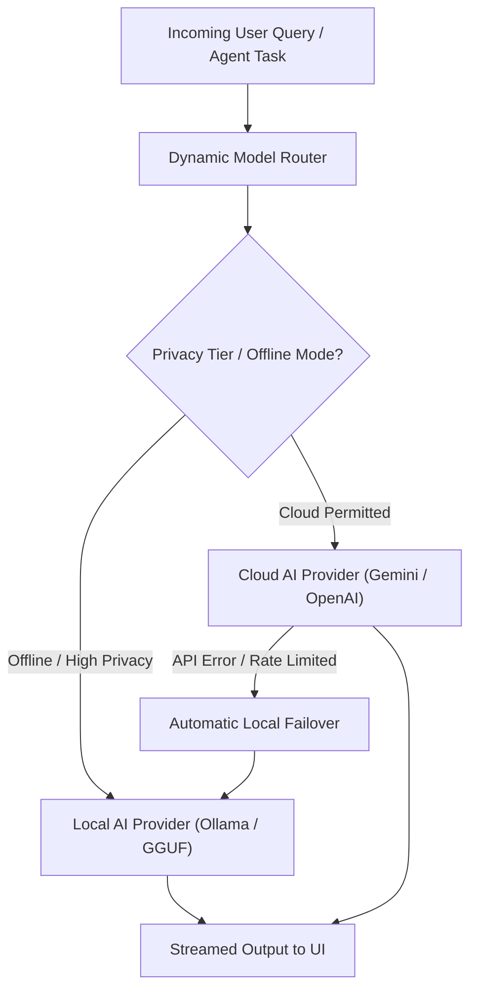

# 🤖 Subsystem Guide: Local AI & Dynamic Model Switching

## 📌 Architecture Overview
The **Local AI & Dynamic Model Switching** subsystem provides a unified model gateway. It allows the assistant to alternate dynamically between cloud foundation models (Google Gemini 1.5/2.0 Flash/Pro, OpenAI GPT-4o) and local on-device runtimes (Ollama, vLLM, llama.cpp GGUF) based on internet availability, user preference, latency requirements, and data privacy tiers.

---

## 🧩 Core Subsystem Modules

| Module File | Component Name | Description & Technology |
| :--- | :--- | :--- |
| [`local_ai_routes.py`](file:///d:/Projects/Ai_Assistant/backend/routes/local_ai_routes.py) | **Local AI REST API** | Endpoints (`/api/local-ai/*`) for discovering local Ollama models, starting/stopping local model processes, and checking VRAM footprint. |
| [`settings_routes.py`](file:///d:/Projects/Ai_Assistant/backend/routes/settings_routes.py) | **Model Configuration API** | Manages API keys (Gemini, OpenAI, Anthropic) and sets active primary and fallback models. |
| [`chat_routes.py`](file:///d:/Projects/Ai_Assistant/backend/routes/chat_routes.py) | **Streaming Chat Gateway** | Server-Sent Events (SSE) streaming engine piping real-time token chunks from the selected model to the web frontend. |

---

## ⚡ Model Switching API Endpoints

* `GET /api/local-ai/status`: Verifies if local daemon (Ollama/llama.cpp) is active and returns loaded models.
* `GET /api/local-ai/models`: Lists installed local weights (e.g. `llama3.2:3b`, `qwen2.5:7b`, `mistral:7b`).
* `POST /api/settings/model`: Sets the active model identifier globally across all agents.
* `POST /api/local-ai/load`: Pre-loads weights into GPU VRAM to ensure zero cold-start delay on first query.
