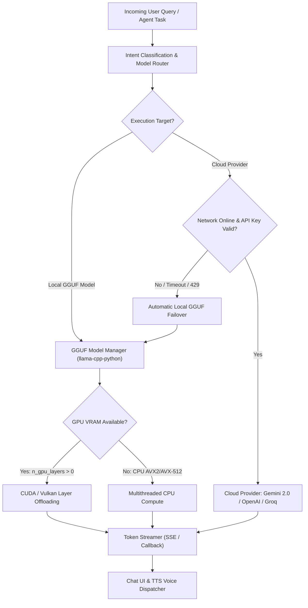

# 🤖 Subsystem Guide: Local AI & Dynamic Model Switching

## 📌 Architecture Overview
The **Local AI & Dynamic Model Switching** subsystem provides a unified, zero-dependency model gateway. PULSAR operates **100% offline by default** using quantized **GGUF** models executed natively via `llama-cpp-python` on CPU or CUDA/ROCm/Vulkan GPUs, with intelligent network-aware failover to cloud providers (Google Gemini, OpenAI GPT-4o, Groq, OpenRouter) when high-capacity cloud intelligence is requested.



---

## 🔒 Why Native GGUF Instead of External Daemons?
In earlier designs, desktop AI apps depended on external background daemons like Ollama. However, external services introduce significant failure modes:
1. **Broken Dependency Chains**: Users must install, update, and manage separate services that may fail to bind ports or start on Windows boot.
2. **IPC Latency & Overhead**: HTTP REST round-trips add 50-100ms latency to every token and intent parse.
3. **Packaging Incompatibilities**: External services cannot be bundled into a single standalone `Pulsar.exe` release.

### The Pure In-Process GGUF Solution:
* PULSAR embeds `llama-cpp-python` directly inside the Python virtual environment and the PyInstaller release bundle (`_internal/`).
* Uses standard 4-bit quantized models (`Q4_K_M`), delivering near 16-bit accuracy at ~4.7 GB RAM footprint.
* Provides direct C++ memory bindings for instantaneous sub-millisecond intent classification.

---

## 🧩 Core Subsystem Modules (`core_ai/ai/`)

| Module File | Component Name | Description & Capabilities |
| :--- | :--- | :--- |
| [`gguf_model_manager.py`](file:///d:/Projects/Ai_Assistant/core_ai/ai/gguf_model_manager.py) | **GGUF Model Manager** | Manages `Llama` instance lifecycle, dynamic thread allocation (`n_threads = CPU cores - 1`), GPU layer offloading (`n_gpu_layers`), and context window caching. |
| [`intent_router.py`](file:///d:/Projects/Ai_Assistant/core_ai/ai/intent_router.py) | **Strict Intent Router** | Routes inputs across 27 system intent categories, distinguishes local OS actions from conversational chat, and enforces zero-latency parsing. |
| [`llm_provider.py`](file:///d:/Projects/Ai_Assistant/core_ai/ai/llm_provider.py) | **Unified LLM Provider** | Common interface abstracting Gemini, OpenAI, Groq, and local GGUF models with standardized streaming, temperature, and token usage metrics. |
| [`network_aware_llm.py`](file:///d:/Projects/Ai_Assistant/core_ai/ai/network_aware_llm.py) | **Network-Aware LLM** | Health-checks cloud endpoints with timeout thresholds; automatically diverts requests to local GGUF if connectivity is lost or API quotas (HTTP 429) are reached. |
| [`local_ai_routes.py`](file:///d:/Projects/Ai_Assistant/backend/routes/local_ai_routes.py) | **Local AI REST API** | Endpoints (`/api/local-ai/*`) for discovering `.gguf` files in `models/`, querying active VRAM/RAM footprints, and hot-swapping models. |
| [`settings_routes.py`](file:///d:/Projects/Ai_Assistant/backend/routes/settings_routes.py) | **Settings & Keys API** | Manages cloud API keys and persists the active primary model in `%APPDATA%\PulsarAI\config\app_settings.json`. |

---

## 🎛️ Dynamic Model Configuration & Quantization

The system auto-detects `.gguf` weights in `models/`:
* Default Model: `Meta-Llama-3.1-8B-Instruct-Q4_K_M.gguf`
* Alternate Models: `Mistral-7B-Instruct-v0.3.Q4_K_M.gguf`, `Qwen2.5-Coder-7B-Instruct-Q4_K_M.gguf`

### Context & Performance Settings (`config/app_settings.json`):
```json
{
  "active_model_type": "local_gguf",
  "local_model_path": "models/Meta-Llama-3.1-8B-Instruct-Q4_K_M.gguf",
  "n_ctx": 4096,
  "n_gpu_layers": -1,
  "n_threads": 8,
  "temperature": 0.7,
  "top_p": 0.9,
  "repeat_penalty": 1.1
}
```
* `n_gpu_layers: -1`: Offloads 100% of layers to GPU VRAM if NVIDIA CUDA or AMD Vulkan runtime is detected.
* `n_gpu_layers: 0`: Runs purely on CPU using multi-threaded AVX2/AVX-512 SIMD instructions (runs smoothly on 8 GB RAM laptops).

---

## ⚡ Cloud Failover Matrix

| Requested Mode | Network Online | Network Offline / API Error |
| :--- | :--- | :--- |
| **`local_gguf`** | Local GGUF (CPU/GPU) | Local GGUF (CPU/GPU) — 100% Unaffected |
| **`gemini`** | Google Gemini 2.0 Flash / Pro | Automatic Failover to Local GGUF |
| **`openai`** | OpenAI GPT-4o / GPT-4o-mini | Automatic Failover to Local GGUF |
| **`hybrid`** | System & OS intents via local GGUF; complex research via Cloud | System & OS intents via local GGUF; complex research via local RAG |

---

## 🧪 Testing Local AI & Routing

Validate local AI models and routing logic:
```powershell
# Run Local AI unit tests
pytest tests/test_local_ai.py -v

# Run command differentiation and routing tests
pytest tests/test_command_differentiation_and_routing.py -v
```
