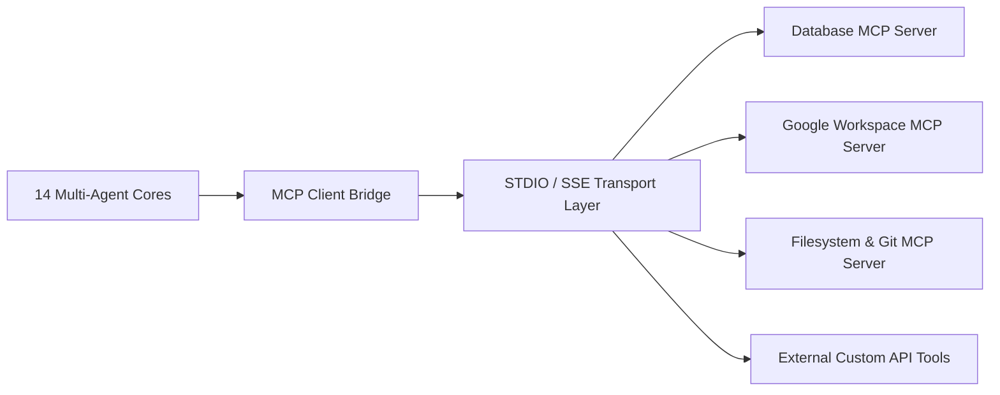

# 🔌 Subsystem Guide: Model Context Protocol (MCP) & Integrations

## 📌 Architecture Overview
The **Model Context Protocol (MCP) & Integrations** subsystem connects `Ai_Assistant` with standardized external tools, databases, and third-party developer APIs. By adopting the open MCP architecture, any local or remote tool server can be hot-plugged into the assistant's agent dispatcher without modifying core source code.



---

## 🧩 Core Subsystem Modules

| Module File | Component Name | Description & Technology |
| :--- | :--- | :--- |
| [`mcp_setup_guide.md`](file:///d:/Projects/Ai_Assistant/docs/capabilities/MCP_SETUP_GUIDE.md) | **MCP Protocol Spec** | Configuration and onboarding guide for connecting external MCP tool servers. |
| [`dispatcher.py`](file:///d:/Projects/Ai_Assistant/core_ai/src/ai_assistant/agents/dispatcher.py) | **Agent Tool Dispatcher** | Maps incoming task capabilities to either registered native agents or external MCP tool servers. |
| [`app_discovery.py`](file:///d:/Projects/Ai_Assistant/core_ai/src/ai_assistant/modules/app_discovery.py) | **Local App Discovery** | Discovers installed Windows desktop applications and exposes them as executable tools. |

---

## ⚡ MCP Server Configuration (`config/mcp_servers.json`)

```json
{
  "mcpServers": {
    "filesystem": {
      "command": "npx",
      "args": ["-y", "@modelcontextprotocol/server-filesystem", "D:/Projects/Ai_Assistant"]
    },
    "sqlite": {
      "command": "uvx",
      "args": ["mcp-server-sqlite", "--db-path", "D:/Projects/Ai_Assistant/memory.db"]
    }
  }
}
```

---

## 🛡️ Security Isolation
* **Explicit Tool Scoping:** External MCP servers run as isolated child processes under standard unprivileged user accounts.
* **Argument Sanitization:** All JSON arguments dispatched to MCP tools pass through input validation regexes before execution.
