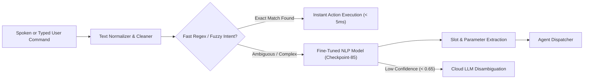

# 💬 Subsystem Guide: Offline NLP & Intent Recognition

## 📌 Architecture Overview
The **Offline NLP & Intent Recognition** subsystem provides sub-millisecond command understanding and intent routing on edge devices without requiring cloud connectivity. It pairs a lightweight fine-tuned offline transformer model (`nlp/offline_command_model`) with a fast pattern-matching Intent Registry.

---

## 🧩 Core Subsystem Modules

| Module File | Component Name | Description & Technology |
| :--- | :--- | :--- |
| [`offline_command_model/`](file:///d:/Projects/Ai_Assistant/nlp/offline_command_model) | **Fine-Tuned NLP Checkpoint** | Local transformer model fine-tuned on assistant intents (App control, System volume, Window management, Timers, Media). |
| [`intent_registry.py`](file:///d:/Projects/Ai_Assistant/core_ai/src/ai_assistant/workflow/intent_registry.py) | **Intent Registry** | High-speed registry mapping intent labels to action handlers and required parameters. |
| [`text_cleaner.py`](file:///d:/Projects/Ai_Assistant/core_ai/src/ai_assistant/voice/text_cleaner.py) | **Text Normalizer** | Strips speech artifacts, filler words ("uh", "um", "please"), and normalizes punctuation for deterministic matching. |

---

## ⚡ Intent Routing Hierarchy

To achieve maximum battery and CPU efficiency on Windows desktops and laptops, intent parsing operates in three stages:

1. **Tier 1: Sub-Millisecond Pattern Matcher:** Common system commands (e.g., *"volume up"*, *"mute"*, *"open chrome"*, *"take screenshot"*) resolve in `< 2ms` via compiled regex tables.
2. **Tier 2: Offline Command Model:** Natural variations (e.g., *"could you launch my web browser please"*) are classified by the local PyTorch transformer model in `< 30ms`.
3. **Tier 3: Generative LLM Fallback:** Conversational queries, multi-step tasks, or completely novel instructions are handed off to the cloud LLM or local GGUF.
