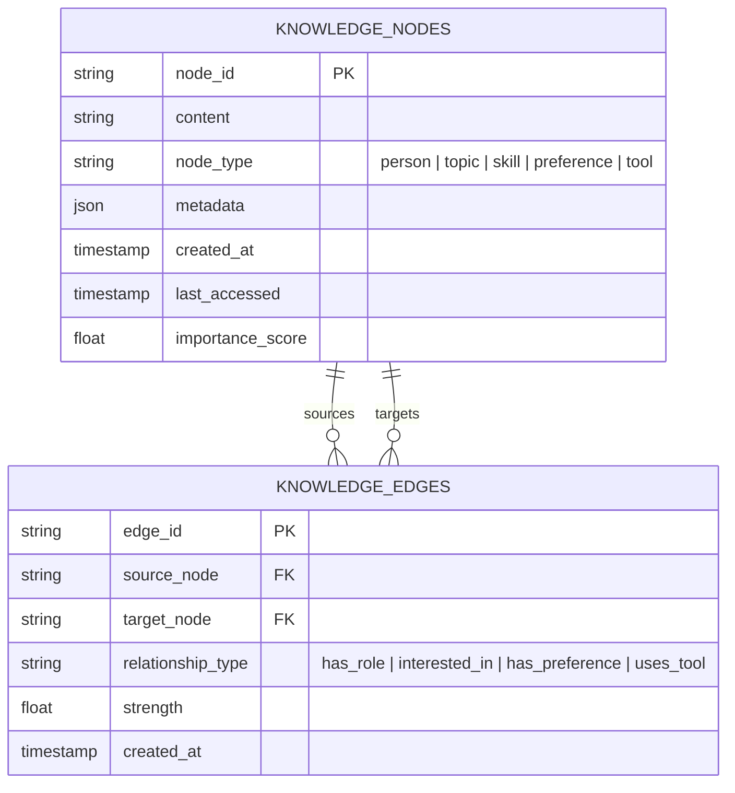

# 🕸️ Subsystem Guide: Personal Knowledge Graph & Memory

## 📌 Architecture Overview
The **Personal Knowledge Graph & Memory** subsystem transforms `Ai_Assistant` from a stateless chatbot into an adaptive, personalized partner. Rather than treating long-term memory as a loose collection of unstructured text, memories are represented as an indexed entity-relationship graph stored in SQLite (`personal_knowledge.db`).

---

## 🧩 Core Subsystem Modules

| Module File | Component Name | Description & Technology |
| :--- | :--- | :--- |
| [`auth_routes.py`](file:///d:/Projects/Ai_Assistant/backend/routes/auth_routes.py) | **Profile & Preference Endpoints** | Initializes user entity nodes, links personal attributes (role, communication style, skills, goals). |
| [`learning_routes.py`](file:///d:/Projects/Ai_Assistant/backend/routes/learning_routes.py) | **Continuous Learning API** | Endpoints (`/api/learning/*`) to query memory nodes, adjust edge strengths, and trigger memory consolidation. |
| [`database_config.py`](file:///d:/Projects/Ai_Assistant/core_ai/src/ai_assistant/core/database_config.py) | **Database Config Manager** | Centralized sandbox resolver ensuring database paths (`personal_knowledge`, `memory`, `users`) resolve to sanctioned directories. |

---

## ⚡ Adaptive Memory Mechanics

1. **Node Importance Decay:** Each node starts with an `importance_score` (0.0 to 1.0). Infrequently accessed nodes experience gradual temporal decay, while recalled nodes refresh their `last_accessed` timestamp.
2. **Relationship Reinforcement:** Repeated user interactions (e.g., repeatedly requesting Python instead of JavaScript) increase the `strength` coefficient of the corresponding edge.
3. **Prompt Injection Integration:** When formatting prompts for Writer or Autonomous agents, top-ranking active preference nodes are dynamically injected into the system prompt to customize responses.
