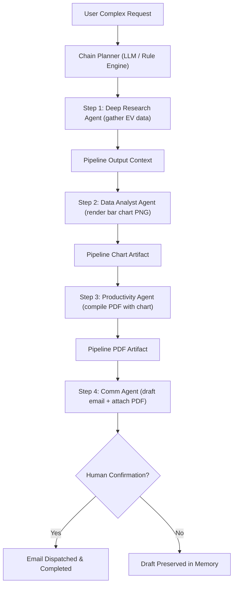

# ⚡ Subsystem Guide: Smart Workflows & Chain-of-Actions

## 📌 Architecture Overview
The **Smart Workflows & Chain-of-Actions** subsystem orchestrates multi-agent, sequential, and directed acyclic graph (DAG) workflows. When a user request spans multiple domains (e.g., *"Research EV sales in 2026, plot a bar chart, generate a PDF report, and email it to my manager"*), the Chain Orchestrator plans, validates, pipelines context, and tracks step execution with rollback support.

---

## 🧩 Core Subsystem Modules

| Module File | Component Name | Description & Technology |
| :--- | :--- | :--- |
| [`chain_routes.py`](file:///d:/Projects/Ai_Assistant/backend/routes/chain_routes.py) | **Chain-of-Actions REST API** | Endpoints (`/api/chain/*`) to propose, simulate, inspect, execute, and abort chained multi-agent plans. |
| [`orchestrator.py`](file:///d:/Projects/Ai_Assistant/core_ai/src/ai_assistant/workflow/orchestrator.py) | **Workflow Orchestrator** | Schedules steps, verifies dependencies, manages execution states (`PENDING`, `RUNNING`, `SUCCESS`, `FAILED`), and streams WebSocket progress. |
| [`complex_workflows.py`](file:///d:/Projects/Ai_Assistant/core_ai/src/ai_assistant/automation/complex_workflows.py) | **Workflow Builder** | Programmatic definitions of reusable compound workflows (e.g., Daily Morning Briefing, Weekly Financial Synthesis). |
| [`rule_engine.py`](file:///d:/Projects/Ai_Assistant/core_ai/src/ai_assistant/automation/rule_engine.py) | **Rule Engine** | Conditional branching logic (If-This-Then-That) based on sensor data, time of day, or system events. |

---

## ⚡ Technical API Endpoints

* `POST /api/chain/plan`: Decomposes natural language into an ordered list of agent actions with explicit inputs.
* `POST /api/chain/execute`: Begins asynchronous execution of the planned chain.
* `GET /api/chain/status/<chain_id>`: Retrieves real-time percentage completion, current executing step, and step artifacts.
* `POST /api/chain/abort/<chain_id>`: Immediately cancels running steps and halts subsequent executions.

---

## 🛡️ Context Piping & Upstream Resolution
Each agent in a chain has access to an `upstream_context` dictionary. If an agent parameter is not explicitly defined in the prompt, the agent searches for output produced by previous steps (e.g., a PDF generator automatically embeds image artifacts output by the preceding Data Analyst step).
