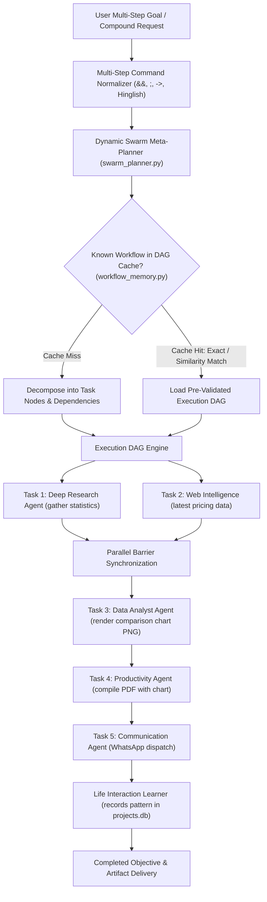

# ⚡ Subsystem Guide: Smart Workflows, Swarm Meta-Planner & DAG Memory

## 📌 Architecture Overview
The **Smart Workflows & Swarm Planning** subsystem coordinates multi-agent collaboration, complex multi-step user goals, and dynamic workflow persistence. When given a multi-step objective (e.g. *"Research EV battery recycling in India, generate a comparison chart, compile a branded PDF report, and send a summary on WhatsApp"*), PULSAR's **Dynamic Swarm Meta-Planner** decomposes the goal into a Directed Acyclic Graph (DAG) of specialized subtasks, assigns them to appropriate agents, caches successful plans in **Workflow Memory**, and coordinates parallel execution.



---

## 🧩 Core Subsystem Modules (`core_ai/core/` & `core_ai/workflow/`)

| Module File | Component Name | Description & Capabilities |
| :--- | :--- | :--- |
| [`swarm_planner.py`](file:///d:/Projects/Ai_Assistant/core_ai/core/swarm_planner.py) | **Dynamic Swarm Meta-Planner** | Analyzes complex, ambiguous prompts, constructs dependency DAGs, assigns agents (`research-001`, `data-001`, etc.), and schedules parallel execution branches. |
| [`workflow_memory.py`](file:///d:/Projects/Ai_Assistant/core_ai/core/workflow_memory.py) | **Workflow Memory DAG Cache** | SQLite-backed DAG cache storing execution paths, success metrics, and artifact lineages. Re-executes recurring tasks with zero planning overhead. |
| [`task_chain_orchestrator.py`](file:///d:/Projects/Ai_Assistant/core_ai/core/task_chain_orchestrator.py) | **Task Chain Orchestrator** | Dispatches tasks to agent workers, pipes upstream outputs into downstream inputs, tracks step states (`PENDING`, `RUNNING`, `SUCCESS`, `FAILED`), and manages rollbacks. |
| [`interaction_learner.py`](file:///d:/Projects/Ai_Assistant/core_ai/knowledge/interaction_learner.py) | **Life Interaction Learner** | Analyzes repeated daily workflows, schedules, and active application shifts to proactively recommend automated chains. |
| [`multi_step_parser.py`](file:///d:/Projects/Ai_Assistant/core_ai/ai/multi_step_parser.py) | **Multi-Step Parser** | Recognizes conjunctions (`&&`, `then`, `aur`, `fir`), sequential arrows (`->`, `=>`), numbered steps (`1. ... 2. ...`), and Hinglish connective phrases. |
| [`chain_routes.py`](file:///d:/Projects/Ai_Assistant/backend/routes/chain_routes.py) | **Chain-of-Actions REST API** | Endpoints (`/api/chain/*`) for proposing plans, executing DAGs, polling real-time step progress, and cancelling tasks. |

---

## 🧠 Dynamic Swarm Meta-Planner (`swarm_planner.py`)

When the user gives a high-level goal, the Swarm Planner:
1. **Decomposes Objectives**: Evaluates semantic requirements and breaks them down into atomic task nodes.
2. **Assigns Specialized Agents**: Maps each subtask to the optimal agent among the 14 multi-agent cores (e.g. math queries to `student-001`, web scraping to `research-001`, file operations to `file-001`).
3. **Resolves Upstream Dependencies**: Identifies which steps can run concurrently (e.g. scraping 3 different web sources simultaneously) and which must wait for prior outputs (e.g. generating a chart requires the scraped data first).
4. **Validates Parameter Schemas**: Validates inputs against each agent's schema before starting execution.

---

## 🗄️ Workflow Memory DAG Cache (`workflow_memory.py`)

Every successful compound action is saved into SQLite `projects.db` with:
* The original natural language prompt embedding.
* The synthesized execution DAG structure.
* Execution time, error rates, and resource costs.

### Benefits of Workflow Memory:
* **Zero Planning Latency**: When a user repeats a similar workflow (*"Export my weekly timesheet and email it to HR"*), PULSAR loads the pre-validated execution DAG in <10ms without calling LLMs.
* **Self-Healing Adaptation**: If a specific agent step historically fails in a workflow (e.g. a website changed its layout), the memory tracks the error and substitutes an alternate agent or fallback path.

---

## ⚡ Multi-Command Compound Syntax Support

PULSAR natively parses both formal and conversational compound syntax:

```bash
# Unix-style chained execution
"open chrome && search machine learning news && open notepad"

# Arrow sequence
"research stock market -> summarize in 3 points -> speak response"

# Natural language Hinglish
"notepad kholo aur usme meeting notes likho fir save kar do"

# Numbered multi-goal prompt
"1. Take screenshot of current screen
 2. Run OCR to extract error text
 3. Search error solution on web"
```

---

## 🧪 Testing Swarm & Chain Orchestration

```powershell
# Test Swarm Planner and Workflow Memory
pytest tests/test_swarm_planner_and_memory.py -v

# Test Multi-Command parsing, Hinglish syntax, and error recovery
pytest tests/test_chain_hinglish_and_recovery.py -v
pytest tests/test_chain_orchestration_v2.py -v
```
