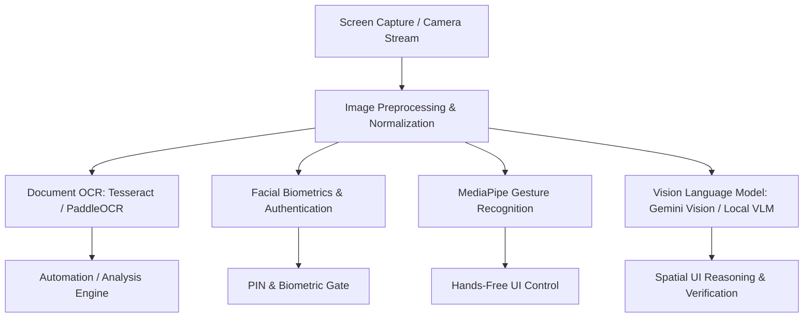

# 👁️ Subsystem Guide: Vision & OCR System

## 📌 Architecture Overview
The **Vision & OCR System** enables multi-modal sensory capabilities across desktop screen inspection, physical document reading, camera streams, biometric facial authentication, and hand gesture recognition.

---

## 🧩 Core Subsystem Modules

| Module File | Component Name | Description & Technology |
| :--- | :--- | :--- |
| [`document_ocr.py`](file:///d:/Projects/Ai_Assistant/core_ai/src/ai_assistant/vision/document_ocr.py) | **Document OCR Engine** | Extracts typed, scanned, and handwritten text from images, invoices, and PDF pages using Tesseract OCR and PaddleOCR fallbacks. |
| [`gemini_vision_provider.py`](file:///d:/Projects/Ai_Assistant/core_ai/src/ai_assistant/vision/gemini_vision_provider.py) | **Gemini Multimodal Provider** | Sends high-resolution screen frames or document crops to Google Gemini 1.5/2.0 Flash/Pro for complex visual scene reasoning. |
| [`vlm_provider.py`](file:///d:/Projects/Ai_Assistant/core_ai/src/ai_assistant/vision/vlm_provider.py) | **Local Vision-Language Model** | Direct bridge to local vision-language models (e.g. Qwen2-VL, MiniCPM-V, LLaVA) running through Ollama or local GGUF runtimes. |
| [`facial_recognition.py`](file:///d:/Projects/Ai_Assistant/core_ai/src/ai_assistant/vision/facial_recognition.py) | **Facial Recognition Gate** | Uses OpenCV and deep face embedding vectors to authenticate the user seated at the computer without requiring manual PIN entry. |
| [`gesture_recognition.py`](file:///d:/Projects/Ai_Assistant/core_ai/src/ai_assistant/vision/gesture_recognition.py) | **Gesture Controller** | Tracks hand landmarks via MediaPipe to trigger hands-free desktop actions (mute microphone, next slide, volume up/down). |

---

## ⚡ Technical Configuration (`config/`)

* `ENABLE_MULTIMODAL`: Master toggle (`true` / `false`).
* `OCR_ENGINE`: Choice of OCR pipeline (`tesseract` | `paddleocr` | `vlm`).
* `TESSERACT_CMD`: Absolute path to `tesseract.exe` (on Windows, typically `C:\Program Files\Tesseract-OCR\tesseract.exe`).
* `CAMERA_INDEX`: Device index for webcam feed (default: `0`).

---

## 🛡️ Error Handling & Fallbacks
1. **Missing Tesseract Binary:** If Tesseract is not installed on the host machine, the OCR module falls back to image analysis via `gemini_vision_provider` or returns a structured error instructing the user to download the OCR executable.
2. **Camera Resource Contention:** If the webcam is locked by another software (e.g. Zoom/Teams), `facial_recognition.py` gracefully catches `cv2.VideoCapture` exceptions and falls back to standard PIN authentication.
