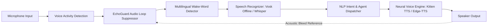

# 🎙️ Subsystem Guide: Voice & Speech Engine

## 📌 Architecture Overview
The **Voice & Speech Engine** in `Ai_Assistant` provides real-time, bidirectional voice interaction for desktop and mobile environments. It combines zero-latency offline keyword detection with state-of-the-art neural speech recognition and speech synthesis, protected by hardware acoustic loop cancellation.

---

## 🧩 Core Subsystem Modules

| Module File | Component Name | Description & Technology |
| :--- | :--- | :--- |
| [`voice_activity_detection.py`](file:///d:/Projects/Ai_Assistant/core_ai/src/ai_assistant/voice/voice_activity_detection.py) | **VAD Module** | Detects active human speech boundaries; discards ambient silence and background fan noise using energy thresholds and WebRTC VAD. |
| [`echo_guard.py`](file:///d:/Projects/Ai_Assistant/core_ai/src/ai_assistant/voice/echo_guard.py) | **EchoGuard** | Prevents the AI from listening to its own voice when speaking through loudspeakers (acoustic echo suppression and ducking). |
| [`enhanced_wake_word.py`](file:///d:/Projects/Ai_Assistant/core_ai/src/ai_assistant/voice/enhanced_wake_word.py) | **Wake-Word Detector** | Lightweight offline listener for activation phrases ("Hey Pulsar", "Assistant") with multilingual support. |
| [`advanced_speech_recognizer.py`](file:///d:/Projects/Ai_Assistant/core_ai/src/ai_assistant/voice/advanced_speech_recognizer.py) | **Speech Recognizer** | Dual engine: Vosk offline acoustic model (`models/vosk-model`) for instant local commands, and faster-whisper for long-form dictation. |
| [`speaker_verification.py`](file:///d:/Projects/Ai_Assistant/core_ai/src/ai_assistant/voice/speaker_verification.py) | **Speaker Biometrics** | Generates voice biometric embeddings to verify that only authorized primary users can execute sensitive voice commands. |
| [`neural_voice_engine.py`](file:///d:/Projects/Ai_Assistant/core_ai/src/ai_assistant/voice/neural_voice_engine.py) | **Neural Voice Engine** | High-fidelity neural voice synthesizer supporting local Kitten-TTS models, Microsoft Edge TTS, and Windows SAPI5. |

---

## ⚡ Technical Configuration (`config/`)

Voice behavior is governed by environment variables and settings:
* `ENABLE_VOICE`: Master toggle (`true` / `false`).
* `VOSK_MODEL_PATH`: Directory of local Vosk acoustic model (`core_ai/src/ai_assistant/models/vosk-model`).
* `WHISPER_MODEL_SIZE`: Whisper model footprint (`tiny`, `base`, `small`, `medium`).
* `WAKE_WORD`: Active activation phrase (default: `"pulsar"`).
* `TTS_ENGINE`: Choice of synthesizer (`kitten` | `edge` | `pyttsx3`).

---

## 🛡️ Stability & Failure Mitigation
1. **Echo Feedback Deadlock:** If the assistant speaks while the microphone is hot, unshielded systems trigger self-reinforcing loops. `EchoGuard` registers an audio reference stream of outgoing TTS playback and mathematically subtracts or gates the input stream until TTS finishes.
2. **Offline Fallback:** If internet connectivity drops, recognition automatically switches from cloud endpoints to local Vosk Kaldi models without terminating the voice loop.
