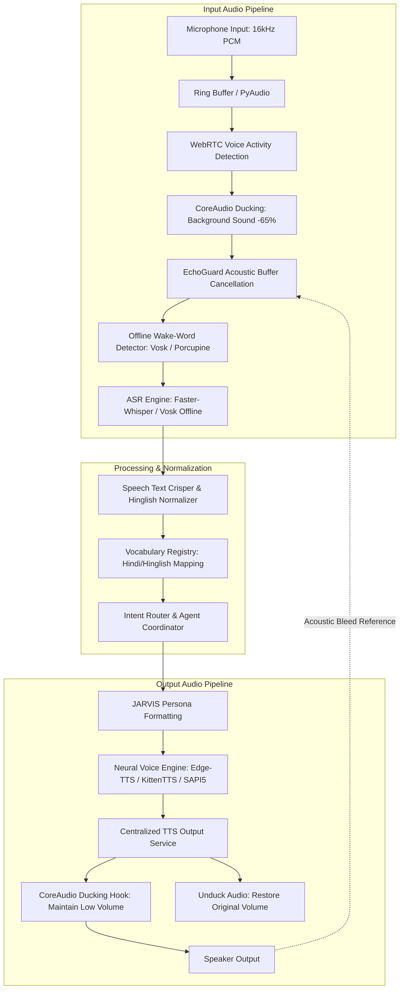

# 🎙️ Subsystem Guide: Voice & Speech Engine

## 📌 Architecture Overview
The **Voice & Speech Engine** in `PULSAR` delivers real-time, bidirectional, conversational speech for Windows 10/11. It combines zero-latency offline keyword detection, neural speech recognition with faster-whisper, reference-counted Windows CoreAudio ducking, acoustic echo loop cancellation, and natural neural voice synthesis (KittenTTS, Edge-TTS, SAPI5).



---

## 🧩 Core Subsystem Modules (`core_ai/voice/`)

| Module File | Component Name | Description & Technology |
| :--- | :--- | :--- |
| [`audio_ducking.py`](file:///d:/Projects/Ai_Assistant/core_ai/voice/audio_ducking.py) | **Windows CoreAudio Ducker** | Reference-counted volume attenuation service using `pycaw` / `IAudioEndpointVolume`. Lowers background media by ~65% during speech/TTS turns and smoothly restores original volume. |
| [`text_cleaner.py`](file:///d:/Projects/Ai_Assistant/core_ai/voice/text_cleaner.py) | **Speech Text Crisper** | Normalizes spoken Hindi/Hinglish phonetics, strips markdown artifacts, emojis, code blocks, and repetitive filler words before sending text to TTS engines. |
| [`vocabulary_registry.py`](file:///d:/Projects/Ai_Assistant/core_ai/voice/vocabulary_registry.py) | **Vocabulary Registry** | Persistent dictionary mapping colloquial Hinglish speech (e.g. *"gaana bajao"*, *"awaaz badhao"*, *"band karo"*) to canonical system actions. |
| [`echo_guard.py`](file:///d:/Projects/Ai_Assistant/core_ai/voice/echo_guard.py) | **EchoGuard** | Hardware acoustic loop suppression. Maintains a time-synchronized ring buffer of outgoing TTS audio to prevent the microphone from recognizing the AI's own voice. |
| [`tts_output_service.py`](file:///d:/Projects/Ai_Assistant/core_ai/voice/tts_output_service.py) | **TTS Output Service** | Thread-safe playback queue managing audio streams, barge-in interrupts, ducking hooks, and completion callbacks. |
| [`advanced_speech_recognizer.py`](file:///d:/Projects/Ai_Assistant/core_ai/voice/advanced_speech_recognizer.py) | **Speech Recognizer** | Dual engine: Vosk Kaldi offline acoustic model (`models/vosk-model`) for instant local commands, and `faster-whisper` (CTranslate2) for accurate dictation. |
| [`neural_voice_engine.py`](file:///d:/Projects/Ai_Assistant/core_ai/voice/neural_voice_engine.py) | **Neural Voice Engine** | Multi-backend synthesizer supporting local Kitten-TTS models, Microsoft Edge TTS, and Windows SAPI5 fallback. |
| [`voice_activity_detection.py`](file:///d:/Projects/Ai_Assistant/core_ai/voice/voice_activity_detection.py) | **VAD Module** | Discards ambient room noise and fan hum using WebRTC VAD energy thresholds before triggering downstream models. |
| [`speaker_verification.py`](file:///d:/Projects/Ai_Assistant/core_ai/voice/speaker_verification.py) | **Speaker Biometrics** | Generates voice biometric embeddings to verify that sensitive commands are issued by the verified primary user. |

---

## 🔊 Windows CoreAudio Reference-Counted Ducking (`audio_ducking.py`)

When playing music on Spotify or watching YouTube, traditional voice assistants struggle because background music drowns out the microphone and confuses Whisper.
* **The Refcount Mechanism**: `duck_audio()` increments an internal counter `_DUCK_COUNT`. If user speech is immediately followed by TTS output, the volume remains ducked seamlessly without jarring volume jumps.
* **Restoration**: `unduck_audio()` decrements the counter. When `_DUCK_COUNT` hits zero, the user's exact original volume level is restored.
* **COM Thread Safety**: Uses `comtypes.CoInitialize()` and `comtypes.CoUninitialize()` per turn, ensuring stability across PyQt/PySide6, asyncio, and worker threads.

---

## 🗣️ Deterministic Speech Text Crisper (`text_cleaner.py`)

Before text is spoken aloud by Edge-TTS or KittenTTS:
1. Strips all markdown: code blocks (````python ... ````), backticks, asterisks, URLs, and file paths.
2. Expands common acronyms and technical terms into phonetically clear spoken equivalents.
3. Cleans colloquial Hinglish phrasing into smooth prosody while preserving conversational nuance.

---

## 🛑 Barge-In & Emergency Interruption

If the assistant is speaking a lengthy response and the user speaks (e.g. *"Stop"*, *"Wait"*, *"Ruko"*, *"Cancel"*):
1. The VAD and wake-word detector trigger an immediate interrupt event.
2. `tts_output_service.py` flushes the playback queue and terminates current audio buffer output in under 50ms.
3. System triggers immediate `unduck_audio()` and shifts the 4D Orb back into `listening` mode.

---

## ⚙️ Configuration & Environment Variables (`.env`)

```env
# Master Voice Toggle
ENABLE_VOICE=true

# Wake Word Activation Phrase
WAKE_WORD=pulsar

# Speech Recognition Engine (faster-whisper | vosk)
ASR_ENGINE=faster-whisper
WHISPER_MODEL_SIZE=base
WHISPER_DEVICE=cpu
WHISPER_COMPUTE_TYPE=int8

# Text-To-Speech Synthesizer (edge | kitten | pyttsx3)
TTS_ENGINE=edge
EDGE_TTS_VOICE=en-US-ChristopherNeural  # or hi-IN-MadhurNeural / hi-IN-SwaraNeural

# Audio Ducking Attenuation (0.35 = 65% reduction)
AUDIO_DUCKING_ATTENUATION=0.35
ENABLE_AUDIO_DUCKING=true
```

---

## 🧪 Testing Voice Subsystems

Run the dedicated voice test benches:
```powershell
# Phase 4 Audio Subsystem (Worker, lifecycle, stream capture)
pytest tests/test_phase4_audio.py -v

# Production Voice Features & Ducking Verification
python scripts/test_production_voice_features.py
python scripts/test_next_gen_voice_features.py
```
