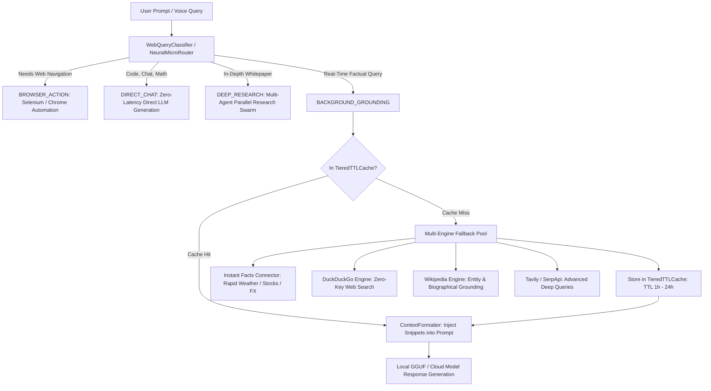

# 🌐 Subsystem Guide: Web Intelligence & Real-Time Search

## 📌 Problem Solved & Motivation
In offline or hybrid AI systems, asking real-time questions (e.g. *"What is the current gold price in India?"*, *"Who won today's cricket match?"*, *"Latest AI news"*) usually fails because local LLMs have an offline training cutoff and either hallucinate or state they have no internet access. Furthermore, simply launching a heavy browser like Chrome for every factual question disrupts the user's workspace.

The **Web Intelligence Subsystem** (`core_ai/integrations/web_intelligence/`) solves this with an autonomous **Tiered Grounding Architecture**:
1. It automatically analyzes the user's prompt using a zero-latency micro-classifier.
2. If real-time facts are needed, it performs **Background Grounding** in under 400ms across multiple search providers.
3. It formats the verified snippets and injects them directly into the LLM context prompt before generation.
4. The user receives fresh, cited, accurate answers seamlessly across Chat, Voice, and Multi-Agent workflows!

---

## 🏛️ Grounding Pipeline Architecture



---

## 🎯 The 4 Web Query Modes (`models.py`)

| Mode | Trigger Condition | Execution Mechanism | Example Prompts |
| :--- | :--- | :--- | :--- |
| `BACKGROUND_GROUNDING` | Real-time events, commodity prices, weather, scores, stock tickers, recent releases. | Silent parallel HTTP search (DuckDuckGo, Instant Facts), snippet extraction, prompt augmentation. | *"Aaj gold ka rate kya hai?"*, *"Latest Python 3.13 release features"*, *"Nifty 50 today"* |
| `BROWSER_ACTION` | Explicit user requests to open websites, fill forms, or interact with web elements. | Dispatches to Selenium / Chrome profile controller (`core_ai/automation/browser_profiles.py`). | *"Open YouTube and search lo-fi"*, *"Go to github.com and check notifications"* |
| `DEEP_RESEARCH` | Complex multi-faceted analytical topics requiring synthesis across 5+ sources. | Dispatches to `deep-research-001` agent; multi-step recursive query expansion. | *"Write a comprehensive report on quantum computing breakthroughs in 2026"* |
| `DIRECT_CHAT` | General coding, math reasoning, creative writing, roleplay, or system OS actions. | Skips web network calls completely; instantaneous local inference. | *"Explain Dijkstra's algorithm"*, *"Write a poem about space"*, *"Open Notepad"* |

---

## 🧩 Core Subsystem Modules

```text
core_ai/integrations/web_intelligence/
├── __init__.py             # Exports get_web_intelligence() singleton
├── service.py              # Master WebIntelligenceService coordinator
├── classifier.py           # WebQueryClassifier detecting query intent and urgency
├── micro_router.py         # NeuralMicroRouter for regex + heuristic token routing
├── models.py               # WebQueryMode, SearchResult, GroundingResult, ScrapedSource
├── cache.py                # TieredTTLCache (in-memory LRU with adaptive TTLs)
├── formatter.py            # ContextFormatter creating markdown grounding injection
├── config.py               # Configuration parser for engine priorities & timeouts
└── engines/
    ├── __init__.py
    ├── base.py             # Abstract BaseSearchEngine class
    ├── instant_facts.py    # Rapid JSON fact connector (weather, crypto, currencies)
    ├── duckduckgo.py       # Robust DuckDuckGo HTML & Lite scraper (Zero API Key required)
    ├── wikipedia.py        # Wikipedia REST API connector for background context
    ├── google_news.py      # RSS / News aggregator for breaking headlines
    ├── tavily.py           # Tavily AI Search API (optional cloud enhancement)
    └── serpapi.py          # SerpApi Google Search provider (optional fallback)
```

---

## ⚡ Tiered TTL Caching (`cache.py`)

To ensure ultra-low latency and prevent search engine rate limits:
* **Instant Facts / Quotes**: 15 minutes TTL (currencies, live sports).
* **Breaking News / Headlines**: 1 hour TTL.
* **General Encyclopedic Data**: 24 hours TTL.
* **LRU Eviction**: Caps at 1,000 active entries with thread-safe lock synchronization.

---

## 🛠️ Configuration & API Keys (`config/app_settings.json` or `.env`)

```env
# Master toggle
ENABLE_WEB_GROUNDING=true

# Search Provider Priority (comma-separated)
WEB_SEARCH_PROVIDERS=duckduckgo,wikipedia,instant_facts

# Optional Cloud Search Keys (system works 100% free without these!)
TAVILY_API_KEY=
SERPAPI_API_KEY=

# Maximum background search latency before fallback (seconds)
WEB_GROUNDING_TIMEOUT=3.5
```

---

## 🧪 Verification & Test Suite

The subsystem is thoroughly tested in [`tests/test_web_intelligence.py`](file:///d:/Projects/Ai_Assistant/tests/test_web_intelligence.py):
```powershell
pytest tests/test_web_intelligence.py -v
```
All 8 test benches validate:
1. `test_classifier_browser_action`: Correctly identifies "open google in chrome" as `BROWSER_ACTION`.
2. `test_classifier_background_grounding`: Correctly identifies "what is today's gold price" as `BACKGROUND_GROUNDING`.
3. `test_classifier_direct_chat_exclusions`: Prevents false positives on coding/creative questions.
4. `test_classifier_deep_research`: Routes deep exploration prompts to multi-agent research.
5. `test_tiered_ttl_cache`: Verifies cache hits and expiration.
6. `test_ground_prompt_flow`: Verifies snippet injection into LLM prompt structure.
7. `test_tool_executor_web_search`: Validates tool integration.
8. `test_intent_executor_routing`: Validates full end-to-end execution loop.
