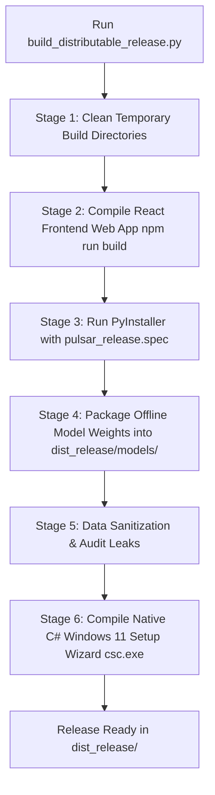

# 📦 Executable Packaging & Windows Distribution Guide

## 📌 Overview
PULSAR features an automated offline distribution engine that packages the entire assistant into a **standalone Windows 10/11 release** requiring **zero manual environment setup, zero Python installation, and zero external downloads**.

The build pipeline produces:
```text
dist_release/
├── PulsarSetup.exe             # Native C# Windows 11 GUI Setup Wizard
└── Pulsar_AI_Assistant/        # Portable Standalone Application
    ├── Pulsar.exe              # Paradigm B Dual-Mode Executable
    ├── UninstallPulsar.exe     # Native Windows Uninstaller
    ├── _internal/              # Bundled Python runtime, PySide6, QtWebEngine, DLLs, React Web UI
    ├── models/                 # 100% Offline GGUF, Whisper, & KittenTTS weights
    ├── .env.example            # Sanitized environment template (Zero API keys!)
    └── README_FIRST.txt        # User quickstart guide
```

---

## 🛠️ Automated Release Builder (`scripts/build_distributable_release.py`)

The primary build script [`scripts/build_distributable_release.py`](file:///d:/Projects/Ai_Assistant/scripts/build_distributable_release.py) orchestrates the entire release pipeline in a single command:

```powershell
# Activate venv
.\venv\Scripts\activate

# Run full release build (PyInstaller compilation + C# Setup Wizard + model bundling)
python scripts/build_distributable_release.py

# Skip PyInstaller if binaries are already compiled (quick installer repackaging)
python scripts/build_distributable_release.py --skip-pyinstaller
```

---

## 🏗️ The Build Pipeline Stages



### Stage 1: Clean Work Environment
Purges stale PyInstaller build artifacts from `build_release_tmp/` and validates disk space.

### Stage 2: React Frontend Production Build
Navigates to `frontend/web-app/` and compiles the production bundle via `npm run build`, outputting optimized JS/CSS assets into `dist/`.

### Stage 3: PyInstaller Paradigm B Compilation (`pulsar_release.spec`)
Invokes PyInstaller with custom options:
* `--onedir` mode for instant application startup (<1s) without extracting temp files to `%TEMP%`.
* Strips unnecessary debug symbols and tests.
* Includes `assets/pulsar_app.ico` with multi-resolution icon sizes (16x16, 32x32, 48x48, 64x64, 128x128, 256x256).
* Enforces `console=False` for silent Windows execution, with safe redirection of `sys.stdout`/`stderr` to `os.devnull`.

### Stage 4: Offline Model Packaging
Copies required local model weights into `dist_release/Pulsar_AI_Assistant/models/`:
* `Meta-Llama-3.1-8B-Instruct-Q4_K_M.gguf` (4.7 GB)
* `faster-whisper-base` (924 MB)
* `KittenTTS` local weights (78 MB)

### Stage 5: Data Sanitization & Leak Audit
Runs privacy tools before distribution:
* [`scripts/clean_personal_data_from_dbs.py`](file:///d:/Projects/Ai_Assistant/scripts/clean_personal_data_from_dbs.py): Scrubs personal chats, phone numbers, and session cookies from SQLite databases.
* [`scripts/clean_hardcoded_paths.py`](file:///d:/Projects/Ai_Assistant/scripts/clean_hardcoded_paths.py): Strips machine-specific file paths.
* [`scripts/audit_hardcoded_data.py`](file:///d:/Projects/Ai_Assistant/scripts/audit_hardcoded_data.py): Scans the final release bundle using regex to ensure no API keys or personal paths remain.

### Stage 6: Native C# Setup Wizard (`PulsarSetup.exe`)
Compiles a native Windows 11 Fluent GUI Installer using the built-in Microsoft .NET Framework C# compiler (`csc.exe`):
* Modern progress bar, license agreement, and customizable installation directory.
* Registers Windows Start Menu and Desktop shortcuts with `AppUserModelID = "Pulsar.AIAssistant.App.v1"`.
* Configures Windows Taskbar identity binding so the app pins cleanly to the taskbar.
* Generates an uninstaller (`UninstallPulsar.exe`) with clean registry unregistration.

---

## 🔒 Privacy & Sanitization Checkpoints

Before sharing `dist_release/` with users or distributing publicly:
```powershell
# 1. Audit codebase and distribution for hardcoded data / API keys
python scripts/audit_hardcoded_data.py

# 2. Sanitize database templates
python scripts/clean_personal_data_from_dbs.py
```
Outputs an audit report confirming zero matches for personal credentials, API keys, or absolute paths.

---

## 🧪 Validating the Packaged App

Verify the packaged release using the automated Phase 5 test bench:
```powershell
pytest tests/test_phase5_windows_app.py -v
```
Validates:
1. `test_native_exe_and_multi_res_ico`: Verifies executable binary headers and icon resource tables.
2. `test_start_menu_shortcut_has_app_user_model_id`: Verifies shortcut COM properties.
3. `test_window_taskbar_identity_binding_and_production_tray_menu`: Verifies system tray integration.
4. `test_pythonw_windowless_none_stdout_safety`: Verifies zero crashes when executed in detached windowless mode.
